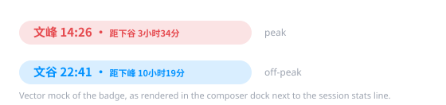

# @ttxl314/dsh-ds-peak-valley

English | [中文](README.zh-CN.md)

A tiny client-only plugin for **DeepSeek Harness (DSH)**: it pins a peak / off-peak badge
(`文峰` / `文谷`) next to the session stats line at the bottom of the conversation
(`1 轮 · 68 步 | LLM ...`), and keeps it in sync with Beijing time.



## What it shows

| State | When (Beijing time) | Color |
| --- | --- | --- |
| **文峰** peak | Mon–Fri 09:00–12:00 and 14:00–18:00 | red `#e5484d` |
| **文谷** valley | every other moment (nights, lunch break, weekends) | blue `#0091ff` |

Badge anatomy:

```text
文峰 14:26 · 距下谷 3小时34分
└─┬─┘ └─┬─┘   └───┬───┘ └──┬──┘
state  Beijing   next switch  time left
       clock     direction    (h/min)
```

- `距下谷` (blue) — the schedule is about to drop into 文谷 at 12:00 / 18:00.
- `距下峰` (red) — the schedule is about to enter 文峰 at 09:00 / 14:00.
- Hovering the badge reveals the full window description and the exact Beijing timestamp.

The windows follow the footnote of the official pricing page:
<https://api-docs.deepseek.com/zh-cn/quick_start/pricing/>.

## Install

Requirements: a DSH installation with a `web` or `desktop` profile, Node.js ≥ 18.

Clone the repository, then register it as a tree-outside bundle of the target profile:

```sh
git clone https://github.com/ttxl314/dsh-ds-peak-valley.git

dsh plugin --profile web add link:<path-to-clone>
```

Or edit the profile manifest by hand (typically `$DSH_HOME/profiles/web/package.json`):

```json
{
  "dependencies": {
    "@ttxl314/dsh-ds-peak-valley": "link:<path-to-clone>"
  },
  "dsh": {
    "profile": {
      "bundles": [
        "@deepseek-ai/dsh-base",
        "@deepseek-ai/dsh-web-app",
        "@ttxl314/dsh-ds-peak-valley"
      ]
    }
  }
}
```

Restart DSH afterwards; the badge appears in the composer dock next to the stats line.

To uninstall, drop the package from `dependencies` and from `dsh.profile.bundles`.

## Behavior

- Registers into the `conversation.composer.dock` slot (`id: ds-peak-valley`, `order: 1`),
  so it sits on the same row as the session stats strip.
- Fully self-contained: Beijing time is derived from the **browser clock** with
  `Intl.DateTimeFormat` (`Asia/Shanghai`), then re-rendered once a minute.
- No configuration, no commands, no slash commands, no settings to toggle.

## How it works

```text
lib/index.js    host entry — a no-op apply(); it exists so the package stays a
                loader entry that dsh-client-modules can scan for dsh.client
lib/client.js   browser bundle — the badge component and the schedule math
cordis.patch.yml  bundle patch — inserts the plugin row into the profile tree
```

- `computeStatus(date)` → `"peak" | "valley"`, from the weekday plus the minute of day.
- `nextTransition(date)` → `{ kind, minutes }`, the next 峰↔谷 boundary and how far away it is
  (weekends collapse into one long valley, so the next change is Monday 09:00).
- The timezone is hard-coded to `Asia/Shanghai` because the pricing schedule is defined in
  Beijing time; the machine's own timezone is irrelevant.
- The bundle registers with `window.__ModuleLoader__.load({ id })` and that `id` must equal the
  package name: the host composes the browser boot graph per package name, so a bundle that
  registers under any other id silently never mounts.

## Privacy

The badge is computed entirely on the client: no HTTP requests, no telemetry, no API key,
no token consumption, and no repository or session data is read. Nothing leaves the page.

## Development

```sh
node test/self-test.mjs   # or: npm test
```

The self-test loads `lib/client.js` against a stub `window.__ModuleLoader__` and a stub
`react`, then asserts:

- status boundaries (09:00 / 12:00 / 14:00 / 18:00, weekends),
- the next-transition countdown (including Fri 18:00 → Mon 09:00),
- the compact `h小时m分` countdown formatting,
- a render smoke test of the badge for both states.

CI runs the same suite on Node 18/20/22 (see `.github/workflows/test.yml`).

## Compatibility

Written against the DSH client plugin API: the `conversation.composer.dock` slot,
the `react` seed module and `window.__ModuleLoader__` with `dsh.client.platform = "web"`.
Tested on DSH desktop and web profiles. If a future DSH release renames the slot or the
loader entry point, only `lib/client.js` needs adjusting.

## Troubleshooting

- **Badge missing** — check that the package name in `dependencies` matches
  `@ttxl314/dsh-ds-peak-valley` exactly, that it is listed in `dsh.profile.bundles`, and
  that the `link:` target still exists after moving the checkout.
- **Wrong state** — the plugin trusts the local clock. Make sure the system time is
  synchronized, then check the hover tooltip, which prints the computed Beijing timestamp.

## License

MIT — see [LICENSE](LICENSE).

Unofficial community plugin; not affiliated with or endorsed by DeepSeek. If DeepSeek
changes its peak/off-peak windows, update `PEAK_WINDOWS` / `PEAK_WEEKDAYS` at the top of
`lib/client.js`.
