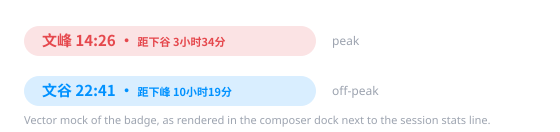

# @ttxl314/dsh-ds-peak-valley

[English](README.md) | 中文

一个极简的 **DeepSeek Harness (DSH) 客户端插件**：在对话底部的统计行
（`1 轮 · 68 步 | LLM ...`）旁边常驻一枚「文峰 / 文谷」徽标，并跟随北京时间自动切换。



## 显示内容

| 状态 | 北京时间 | 颜色 |
| --- | --- | --- |
| **文峰**（高峰） | 周一至周五 09:00–12:00、14:00–18:00 | 红 `#e5484d` |
| **文谷**（空闲） | 其余所有时段（夜间、午休、周末） | 蓝 `#0091ff` |

徽标结构：

```text
文峰 14:26 · 距下谷 3小时34分
└─┬─┘ └─┬─┘   └───┬───┘ └──┬──┘
 状态  北京时间   切换方向   剩余时长
```

- `距下谷`（蓝字）：即将在 12:00 / 18:00 进入文谷。
- `距下峰`（红字）：即将在 09:00 / 14:00 进入文峰。
- 鼠标悬停可看到完整时段说明与当前北京时间的精确时刻。

时段规则与官方定价页脚注保持一致：
<https://api-docs.deepseek.com/zh-cn/quick_start/pricing/>。

## 安装

前置条件：已安装 DSH（`web` 或 `desktop` profile 均可），Node.js ≥ 18。

克隆仓库后，把它作为树外 bundle 注册到目标 profile：

```sh
git clone https://github.com/ttxl314/dsh-ds-peak-valley.git

dsh plugin --profile web add link:<本地克隆路径>
```

也可以直接编辑 profile 清单（通常是 `$DSH_HOME/profiles/web/package.json`）：

```json
{
  "dependencies": {
    "@ttxl314/dsh-ds-peak-valley": "link:<本地克隆路径>"
  },
  "dsh": {
    "profile": {
      "bundles": [
        "@deepseek-ai/dsh-base",
        "@deepseek-ai/dsh-web-app",
        "@ttxl314/dsh-ds-peak-valley"
      ]
    }
  }
}
```

重启 DSH 后，徽标就会出现在对话底部的 composer dock 中，与统计行并排。

卸载：从 `dependencies` 和 `dsh.profile.bundles` 中同时移除该包即可。

## 行为说明

- 注册到 `conversation.composer.dock` 槽位（`id: ds-peak-valley`，`order: 1`），
  因此与统计行同一行显示。
- 完全自包含：用浏览器**本地时钟** + `Intl.DateTimeFormat`（`Asia/Shanghai`）
  换算北京时间，每分钟刷新一次。
- 没有配置项、没有命令、没有开关。

## 实现

```text
lib/index.js      宿主入口 —— 空的 apply()，仅用于让包保持为 loader entry，
                  dsh-client-modules 才能扫描到 dsh.client 声明
lib/client.js     浏览器 bundle —— 徽标组件与时段计算
cordis.patch.yml  bundle patch —— 把插件行插入 profile 的插件树
```

- `computeStatus(date)` → `"peak" | "valley"`，由「星期几 + 当天分钟数」判定。
- `nextTransition(date)` → `{ kind, minutes }`，下一次 峰↔谷 边界及剩余分钟数
  （周末是连续文谷，故下一次切换是周一 09:00）。
- 时区硬编码为 `Asia/Shanghai`：定价时段以北京时间为准，与机器本地时区无关。

## 隐私

徽标全部在客户端本地计算：不发起任何 HTTP 请求、不上报遥测、不需要 API Key、
不消耗 token，也不读取会话或仓库内容。任何数据都不会离开页面。

## 开发

```sh
node test/self-test.mjs   # 或 npm test
```

自测会用假的 `window.__ModuleLoader__` 与假的 `react` 加载 `lib/client.js`，覆盖：

- 状态边界（09:00 / 12:00 / 14:00 / 18:00、周末）；
- 下一次切换的倒计时（含周五 18:00 → 周一 09:00）；
- `h小时m分` 倒计时格式化；
- 两种状态下徽标的渲染冒烟测试。

CI 在 Node 18/20/22 上跑同一套测试（见 `.github/workflows/test.yml`）。

## 兼容性

面向 DSH 客户端插件 API 编写：`conversation.composer.dock` 槽位、`react` seed 模块、
以及 `dsh.client.platform = "web"` 下的 `window.__ModuleLoader__`。
已在 DSH 桌面版与 Web profile 上验证。如果未来 DSH 改动槽位名或 loader 入口，
只需调整 `lib/client.js`。

## 常见问题

- **看不到徽标** —— 检查 `dependencies` 里的包名是否与 `@ttxl314/dsh-ds-peak-valley`
  完全一致、是否已加入 `dsh.profile.bundles`，以及克隆目录移动后 `link:` 路径是否失效。
- **状态不对** —— 插件信任本地时钟。请先同步系统时间，再看悬停提示里打印的北京时间。

## 许可证

MIT，详见 [LICENSE](LICENSE)。

非官方社区插件，与 DeepSeek 无隶属或背书关系。若 DeepSeek 调整峰谷时段，
修改 `lib/client.js` 顶部的 `PEAK_WINDOWS` / `PEAK_WEEKDAYS` 即可。
