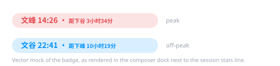

# @ttxl314/dsh-ds-peak-valley

[](https://www.npmjs.com/package/@ttxl314/dsh-ds-peak-valley)
[](https://github.com/ttxl314/dsh-ds-peak-valley/actions/workflows/test.yml)

[English](README.md) | 中文

一个极简的 **DeepSeek Harness (DSH) 客户端插件**：在对话底部的统计行
（`1 轮 · 68 步 | LLM ...`）旁边常驻一枚「文峰 / 文谷」徽标，并跟随北京时间自动切换。

> **安装：** 在**插件 → 添加插件**里粘贴 `@ttxl314/dsh-ds-peak-valley`，或执行
> `dsh plugin --profile web add @ttxl314/dsh-ds-peak-valley`。详见[安装](#安装)。



## 显示内容

| 状态 | 北京时间 | 颜色 |
| --- | --- | --- |
| **文峰**（高峰） | 周一至周五 09:00–12:00、14:00–18:00 | 红 `#e5484d` |
| **文谷**（空闲） | 其余所有时段（夜间、午休、周末） | 蓝 `#0091ff` |

徽标结构：

```text
文峰 14:26 · 距下谷 3小时34分
└─┬─┘ └─┬─┘   └───┬───┘ └──┬──┘
 状态  北京时间   切换方向   剩余时长
```

- `距下谷`（蓝字）：即将在 12:00 / 18:00 进入文谷。
- `距下峰`（红字）：即将在 09:00 / 14:00 进入文峰。
- 超过 24 小时的倒计时改用天显示：`距下峰 2天15小时`，而不是 `63小时`（周末空档较长）。
- 鼠标悬停可看到完整时段说明与当前北京时间的精确时刻。

时段规则与官方定价页脚注保持一致：
<https://api-docs.deepseek.com/zh-cn/quick_start/pricing/>。

## 安装

前置条件：已安装 DSH（`web` 或 `desktop` profile 均可）。插件已发布到 npm：
[`@ttxl314/dsh-ds-peak-valley`](https://www.npmjs.com/package/@ttxl314/dsh-ds-peak-valley)，
不需要先克隆仓库。

### 方式一：插件管理器（推荐）

DSH 侧边栏 → **插件** → **添加插件**，粘贴：

```text
@ttxl314/dsh-ds-peak-valley@0.1.2
```

去掉 `@0.1.2` 就是装最新版，留着则锁定版本。管理器会从 npm 解析、装进当前 profile 并启用。

等价命令行：

```sh
dsh plugin --profile web add @ttxl314/dsh-ds-peak-valley@0.1.2
```

刷新页面（或重启 DSH），徽标就会出现在统计行旁边。

### 方式二：本地源码（开发用）

```sh
git clone https://github.com/ttxl314/dsh-ds-peak-valley.git

dsh plugin --profile web add link:<本地克隆路径>
```

插件管理器的「添加插件」输入框也直接接受该绝对路径，另外还支持 `npm pack` 出的 `.tgz`
和 Git 地址，例如 `https://github.com/ttxl314/dsh-ds-peak-valley#v0.1.2`。

### 验证装好了

- 「插件」页里能看到该组合包已启用，并有一行 `ds-peak-valley`。
- 对话底部统计行 `1 轮 · 68 步 | LLM ...` 旁边出现 `文峰 14:26 · 距下谷 3小时34分`（或 `文谷 …`）。
- 在包目录跑 `node test/self-test.mjs`，应输出 `OK — 36 schedule cases`。

### 升级

```sh
dsh plugin --profile web add @ttxl314/dsh-ds-peak-valley@latest
```

### 卸载

```sh
dsh plugin --profile web remove @ttxl314/dsh-ds-peak-valley
```

用桌面版 profile 的话，把上面命令里的 `--profile web` 换成 `--profile desktop`。

## 行为说明

- 注册到 `conversation.composer.dock` 槽位（`id: ds-peak-valley`，`order: 1`），
  因此与统计行同一行显示。
- 完全自包含：用浏览器**本地时钟** + `Intl.DateTimeFormat`（`Asia/Shanghai`）
  换算北京时间，每分钟刷新一次。
- 没有配置项、没有命令、没有开关。

## 实现

```text
lib/index.js      宿主入口 —— 空的 apply()，仅用于让包保持为 loader entry，
                  dsh-client-modules 才能扫描到 dsh.client 声明
lib/client.js     浏览器 bundle —— 徽标组件与时段计算
cordis.patch.yml  bundle patch —— 把插件行插入 profile 的插件树
```

- `computeStatus(date)` → `"peak" | "valley"`，由「星期几 + 当天分钟数」判定。
- `nextTransition(date)` → `{ kind, minutes }`，下一次 峰↔谷 边界及剩余分钟数
  （周末是连续文谷，故下一次切换是周一 09:00）。
- 时区硬编码为 `Asia/Shanghai`：定价时段以北京时间为准，与机器本地时区无关。
- 浏览器 bundle 以 `window.__ModuleLoader__.load({ id })` 注册，`id` 必须与 `package.json` 的包名
  完全一致：宿主按包名组装 boot graph，id 不一致时这一行永远不会被满足（徽标静默不出现）。

## 隐私

徽标全部在客户端本地计算：不发起任何 HTTP 请求、不上报遥测、不需要 API Key、
不消耗 token，也不读取会话或仓库内容。任何数据都不会离开页面。

## 开发

```sh
node test/self-test.mjs   # 或 npm test
```

自测会用假的 `window.__ModuleLoader__` 与假的 `react` 加载 `lib/client.js`，覆盖：

- 状态边界（09:00 / 12:00 / 14:00 / 18:00、周末）；
- 下一次切换的倒计时（含周五 18:00 → 周一 09:00）；
- 倒计时格式化（`45分` / `2小时30分` / `2天15小时`）；
- 两种状态下徽标的渲染冒烟测试。

CI 在 Node 18/20/22 上跑同一套测试（见 `.github/workflows/test.yml`）。

## 兼容性

面向 DSH 客户端插件 API 编写：`conversation.composer.dock` 槽位、`react` seed 模块、
以及 `dsh.client.platform = "web"` 下的 `window.__ModuleLoader__`。
已在 DSH 0.2.1-rc.5 的桌面版与 Web profile 上验证。如果未来 DSH 改动槽位名或 loader 入口，
只需调整 `lib/client.js`。

## 常见问题

- **看不到徽标** —— 检查 `dependencies` 里的包名是否与 `@ttxl314/dsh-ds-peak-valley`
  完全一致、是否已加入 `dsh.profile.bundles`，以及克隆目录移动后 `link:` 路径是否失效。
- **状态不对** —— 插件信任本地时钟。请先同步系统时间，再看悬停提示里打印的北京时间。
- **改包名后徽标消失** —— bundle 以包名注册，重命名时必须同时改 `package.json`、`cordis.patch.yml` 和 `lib/client.js` 里的 `id`；三者不一致时 `npm test` 会直接失败。

## 更新日志

发布历史见 [CHANGELOG.md](CHANGELOG.md)。

## 许可证

MIT，详见 [LICENSE](LICENSE)。

非官方社区插件，与 DeepSeek 无隶属或背书关系。若 DeepSeek 调整峰谷时段，
修改 `lib/client.js` 顶部的 `PEAK_WINDOWS` / `PEAK_WEEKDAYS` 即可。
